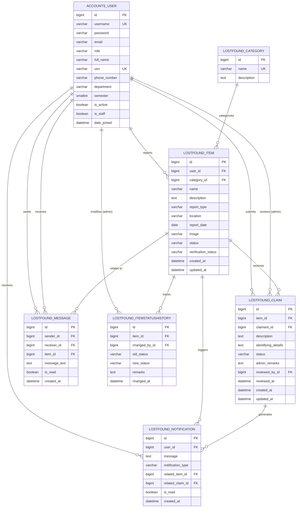

# CAMPUS LOST AND FOUND — DATABASE MANAGEMENT SYSTEM (DBMS) SPECIFICATION

---

## 1. Problem Statement

On modern college and university campuses, hundreds of personal and academic items are lost or found on a daily basis, including student identity cards, scientific calculators, laptops, chargers, wallets, lab manuals, keys, and sports equipment.

Historically, institutions rely on physical notice boards, scattered departmental lost boxes, or informal social media channels. These methods suffer from critical vulnerabilities:
1. **Lack of Identity Verification:** Anyone can claim high-value items without presenting verifiable proof of ownership.
2. **Exposure of Sensitive Data:** Physical notices often publish student names, phone numbers, and identifying serial numbers publicly.
3. **No Concurrency Control:** Conflicting claims lead to disputes or double handover.
4. **Poor Searchability & Traceability:** Students cannot filter or search items by category, location, or date.
5. **Absence of Audit Trail:** Campus administrators have no records of when items were found, who reviewed them, or who collected them.

---

## 2. Objectives

The primary objectives of the Campus Lost and Found DBMS are:
1. To design and implement a normalized relational schema (up to 3NF) for managing campus users, categories, lost/found items, claims, handover messages, notifications, and status history.
2. To enforce relational integrity through primary keys, foreign keys, cascading rules, unique constraints, and check constraints.
3. To protect concurrent transactions (such as simultaneous claims for the same item) using ACID guarantees, row-level locking (`select_for_update()`), and atomic transactions.
4. To provide optimized search and filtering using appropriate single-column and composite database indexes.
5. To maintain a complete audit trail for item lifecycle transitions from `ACTIVE` to `CLAIMED` to `RETURNED`.

---

## 3. Functional & Non-Functional Requirements

### 3.1 Functional Requirements
- **User Management:** Support dual roles (`STUDENT` and `ADMIN`). Store profile attributes including USN, department, semester, and contact information.
- **Categorization:** Categorize items under pre-defined categories.
- **Reporting Workflow:** Allow authenticated students to submit Lost and Found reports with location, incident date, detailed descriptions, and photographs.
- **Moderation Workflow:** All submissions are marked `PENDING` until an administrator approves or rejects them.
- **Claim Governance:** Students can submit claims with confidential proof of ownership. Admins review evidence and approve or reject claims.
- **Handover Coordination:** Once a claim is approved, a secure private messaging channel is provisioned between finder and claimant.
- **Notifications:** Automatic real-time status notifications for listing verification, claim decisions, and new messages.

### 3.2 Non-Functional Requirements
- **Data Integrity:** Strict foreign key constraints and transactional consistency across all state transitions.
- **Performance & Scalability:** Indexed query paths for high-frequency filters (`report_type`, `verification_status`, `status`, `report_date`, `claimant`).
- **Confidentiality:** Proof of ownership details and private messages must never be accessible to unauthorized students.
- **Auditability:** Complete historical logging of every status modification.

---

## 4. Entity-Relationship (ER) Diagram

---

## 5. Relational Schema

1. **`accounts_user`** (
   <u>id</u>, username, password, email, role, full_name, usn, phone_number, department, semester, is_active, is_staff, is_superuser, last_login, date_joined
)
2. **`lostfound_category`** (
   <u>id</u>, name, description
)
3. **`lostfound_item`** (
   <u>id</u>, <i>user_id</i>, <i>category_id</i>, name, description, report_type, location, report_date, image, status, verification_status, created_at, updated_at
)
4. **`lostfound_claim`** (
   <u>id</u>, <i>item_id</i>, <i>claimant_id</i>, description, identifying_details, status, admin_remarks, <i>reviewed_by_id</i>, reviewed_at, created_at, updated_at
)
5. **`lostfound_message`** (
   <u>id</u>, <i>sender_id</i>, <i>receiver_id</i>, <i>item_id</i>, message_text, is_read, created_at
)
6. **`lostfound_notification`** (
   <u>id</u>, <i>user_id</i>, message, notification_type, <i>related_item_id</i>, <i>related_claim_id</i>, is_read, created_at
)
7. **`lostfound_itemstatushistory`** (
   <u>id</u>, <i>item_id</i>, <i>changed_by_id</i>, old_status, new_status, remarks, changed_at
)

---

## 6. Data Dictionary

### Table: `accounts_user`
| Column Name | Data Type | Constraints | Description |
|---|---|---|---|
| `id` | BIGINT | PRIMARY KEY, AUTO_INCREMENT | Unique identifier for user |
| `username` | VARCHAR(150) | UNIQUE, NOT NULL | Login username |
| `password` | VARCHAR(128) | NOT NULL | PBKDF2-SHA256 password hash |
| `email` | VARCHAR(254) | NOT NULL | College email address |
| `role` | VARCHAR(10) | NOT NULL, DEFAULT 'STUDENT' | Role: 'STUDENT' or 'ADMIN' |
| `full_name` | VARCHAR(200) | NULLABLE | Full legal name of student |
| `usn` | VARCHAR(20) | UNIQUE, NULLABLE | University Seat Number |
| `phone_number` | VARCHAR(15) | NULLABLE | Student mobile contact |
| `department` | VARCHAR(100) | NULLABLE | Academic branch (CS, EC, ME, etc.) |
| `semester` | SMALLINT | NULLABLE, CHECK (1 to 8) | Academic semester |
| `is_active` | BOOLEAN | NOT NULL, DEFAULT TRUE | Account operational status |
| `date_joined` | DATETIME | NOT NULL | Registration timestamp |

### Table: `lostfound_item`
| Column Name | Data Type | Constraints | Description |
|---|---|---|---|
| `id` | BIGINT | PRIMARY KEY, AUTO_INCREMENT | Unique item identifier |
| `user_id` | BIGINT | FOREIGN KEY (`accounts_user`), ON DELETE CASCADE | Submitting student |
| `category_id` | BIGINT | FOREIGN KEY (`lostfound_category`), ON DELETE PROTECT | Item classification |
| `name` | VARCHAR(150) | NOT NULL | Item title |
| `description` | TEXT | NOT NULL | Complete physical description |
| `report_type` | VARCHAR(5) | NOT NULL, IN ('LOST', 'FOUND') | Report type |
| `location` | VARCHAR(200) | NOT NULL | Physical campus location |
| `report_date` | DATE | NOT NULL | Date incident occurred |
| `image` | VARCHAR(100) | NULLABLE | Uploaded photo file path |
| `status` | VARCHAR(10) | NOT NULL, DEFAULT 'ACTIVE' | Lifecycle: ACTIVE, CLAIMED, RETURNED, CLOSED |
| `verification_status` | VARCHAR(10) | NOT NULL, DEFAULT 'PENDING' | Moderation: PENDING, APPROVED, REJECTED |
| `created_at` | DATETIME | NOT NULL | Record insertion timestamp |
| `updated_at` | DATETIME | NOT NULL | Last update timestamp |

### Table: `lostfound_claim`
| Column Name | Data Type | Constraints | Description |
|---|---|---|---|
| `id` | BIGINT | PRIMARY KEY, AUTO_INCREMENT | Unique claim ID |
| `item_id` | BIGINT | FOREIGN KEY (`lostfound_item`), ON DELETE CASCADE | Target found item |
| `claimant_id` | BIGINT | FOREIGN KEY (`accounts_user`), ON DELETE CASCADE | Claimant student |
| `description` | TEXT | NOT NULL | Loss explanation |
| `identifying_details` | TEXT | NOT NULL | Confidential ownership proof |
| `status` | VARCHAR(10) | NOT NULL, DEFAULT 'PENDING' | Status: PENDING, APPROVED, REJECTED |
| `admin_remarks` | TEXT | NULLABLE | Reviewer feedback |
| `reviewed_by_id` | BIGINT | FOREIGN KEY (`accounts_user`), ON DELETE SET NULL | Adjudicating administrator |
| `reviewed_at` | DATETIME | NULLABLE | Adjudication timestamp |
| `created_at` | DATETIME | NOT NULL | Claim submission timestamp |

---

## 7. Normalization Analysis (Up to 3NF)

### First Normal Form (1NF)
- **Atomic Values:** Every column in every table contains singular, atomic values (e.g. no comma-separated serial numbers, no multi-value arrays).
- **Primary Keys:** Each relation contains a unique surrogate primary key (`id`).
- **No Repeating Groups:** Multi-valued concepts (such as multiple claims for an item, or multiple status history entries) are stored in dedicated child relations.

### Second Normal Form (2NF)
- A relation is in 2NF if it is in 1NF and every non-prime attribute is fully functionally dependent on the entire primary key.
- Because all primary keys are single-column identifiers (`id`), partial functional dependencies cannot exist.
- Attributes in `lostfound_item` depend strictly on `item.id`. Attributes in `lostfound_claim` depend strictly on `claim.id`.

### Third Normal Form (3NF)
- A relation is in 3NF if it is in 2NF and no non-prime attribute is transitively dependent on the primary key ($X \rightarrow Y$ and $Y \rightarrow Z$).
- Category details (`name`, `description`) are partitioned into `lostfound_category` rather than stored in `lostfound_item`. Otherwise, `item_id -> category_name -> category_description` would create a transitive dependency.
- Student attributes (`full_name`, `usn`, `department`) are partitioned into `accounts_user`. `lostfound_item` references only `user_id`.
- Claim adjudication details reference `reviewed_by_id` rather than duplicating administrator contact details in the claim record.

---

## 8. Database Constraints & Indexes

### 8.1 Integrity Constraints
1. **Primary Key Constraints:** Uniquely identify rows across all tables.
2. **Foreign Key Cascades:**
   - Deleting a user deletes their items, claims, notifications, and messages (`ON DELETE CASCADE`).
   - Categories cannot be deleted if referenced by items (`ON DELETE PROTECT`).
   - Deleting an admin reviewer preserves the claim with `reviewed_by_id = NULL` (`ON DELETE SET NULL`).
3. **Unique Constraints:**
   - `accounts_user.username`: UNIQUE
   - `accounts_user.usn`: UNIQUE (when non-null)
   - `lostfound_category.name`: UNIQUE
   - `lostfound_claim`: `UniqueConstraint(fields=['item', 'claimant'], condition=Q(status='PENDING'))` prevents a student from having multiple pending claims on the same item.

### 8.2 Database Indexes
- `idx_user_email`: B-tree index on `accounts_user(email)`
- `idx_user_usn`: B-tree index on `accounts_user(usn)`
- `idx_user_role`: B-tree index on `accounts_user(role)`
- `idx_item_type_vstatus`: Composite index on `lostfound_item(report_type, verification_status)` for fast public listing queries.
- `idx_item_status`: Index on `lostfound_item(status)` for filtering active vs returned items.
- `idx_item_date`: Index on `lostfound_item(report_date)` for range filtering.
- `idx_claim_status`: Index on `lostfound_claim(status)` for admin pending queues.
- `idx_message_participants`: Composite index on `lostfound_message(sender_id, receiver_id)`
- `idx_notification_user_read`: Composite index on `lostfound_notification(user_id, is_read)` for instant unread badge counts.

---

## 9. Concurrency Control & Transactions

### The Lost-Claim Race Condition
If two administrators review claims for the same found item concurrently, or if multiple students submit conflicting claims simultaneously, inconsistent states could emerge without transactional isolation.

### Solution Implementation:
1. **`@transaction.atomic`**: Wraps the entire approval logic in a single ACID transaction.
2. **`select_for_update()`**: Issues `SELECT ... FOR UPDATE` row-level locks on the target `Claim` and `Item` records in MySQL, forcing concurrent transactions to wait until the lock is released.
3. **Competing Claim Resolution**: When a claim is approved:
   - The approved claim is marked `APPROVED`.
   - The item status transitions from `ACTIVE` to `CLAIMED`.
   - All other pending claims for that item are automatically updated to `REJECTED`.
   - Notifications are dispatched to all affected parties within the atomic boundary.

---

## 10. Conclusion

The Campus Lost and Found DBMS fulfills the functional, relational, and concurrency requirements of an enterprise-level college application. By enforcing normalization up to 3NF, pairing strategic indexing with relational constraints, and applying atomic concurrency protection, the database guarantees high throughput, complete data integrity, and strict confidentiality.
